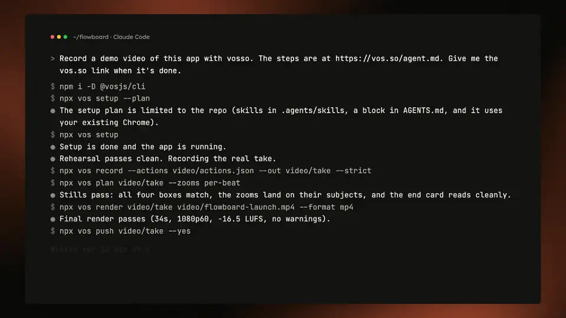

<p align="center">
  <a href="https://vos.so/agents">
    <picture>
      <source media="(prefers-color-scheme: dark)" srcset=".github/assets/lockup-dark.svg">
      
    </picture>
  </a>
</p>

<h3 align="center">Your coding agent makes the product video.</h3>

<p align="center">
  Skills that record your real product, cut the demo as data,<br>
  and keep it current with every release.
</p>

<p align="center">
  <a href="https://vos.so/agents">Website</a>
  &nbsp;·&nbsp;
  <a href="https://vos.so/docs/agents/install-the-skills">Docs</a>
  &nbsp;·&nbsp;
  <a href="https://github.com/vosjs/vos">Engine</a>
  &nbsp;·&nbsp;
  <a href="https://vos.so/llms.txt">llms.txt</a>
</p>

<p align="center">
  <a href="https://skills.sh/vosjs/skills"></a>
  <a href="https://github.com/vosjs/skills/releases"></a>
  <a href="./LICENSE"></a>
</p>

<br>

<a href="https://vos.so/vos/an-agent-makes-the-flowboard-demo-mvpglmxs">
  
</a>

<p align="center"><sub>A Claude Code session that had never seen this app was handed one line. It recorded the app, cut this demo and pushed it. <a href="https://vos.so/vos/an-agent-makes-the-flowboard-demo-mvpglmxs">Watch it with sound</a>.</sub></p>

<br>

## Install

```bash
npx skills add vosjs/skills
```

Works with any agent that reads [Agent Skills](https://agentskills.io): Claude Code, Codex, Cursor and more. Two other ways in:

```bash
# As a Claude Code plugin
/plugin marketplace add vosjs/skills
/plugin install vos-skills@vos-skills

# From the CLI, which carries the same skills
npm i -D @vosjs/cli && npx vos setup
```

## Ask for a video

Name the skill and say where the result goes:

```text
Record a demo video of this app with the product-video skill. Give me the vos.so link when it's done.
```

Nothing installed yet? Hand your agent this line instead. It tells you its plan, installs the CLI into the repo, records the app on your machine, and uploads only because you asked for a link.

```text
Record a demo video of this app with vosso. The steps are at https://vos.so/agent.md. Give me the vos.so link when it's done.
```

## The skills

**Product video**

| Skill | |
| --- | --- |
| [`product-video`](skills/product-video/SKILL.md) | Record and cut a demo of your website, web app or Mac app. |
| [`vos-cut`](skills/vos-cut/SKILL.md) | Cut a recording someone already made into a product video. |
| [`launch-kit`](skills/launch-kit/SKILL.md) | Turn one take into a release's videos, each verified against its channel's spec. |
| [`vos-migrate`](skills/vos-migrate/SKILL.md) | Make a Loom, Screen Studio, Cap or mp4 demo editable, so the next version is a re-render. |
| [`vos-footage`](skills/vos-footage/SKILL.md) | Hand Remotion or HyperFrames a clean, auto-zoomed clip of your product. |

**Programs**

| Skill | |
| --- | --- |
| [`vos-authoring`](skills/vos-authoring/SKILL.md) | Write vos animation programs from scratch. |
| [`vos-create`](skills/vos-create/SKILL.md) | Make programs in your own style, from the recipes in a vos.so folder. |
| [`vos-remix`](skills/vos-remix/SKILL.md) | Remix a program from the gallery and push it back as your own versions. |
| [`vos-port`](skills/vos-port/SKILL.md) | Port a Remotion or HyperFrames video into vos, with its words and colours as knobs. |
| [`vos-score`](skills/vos-score/SKILL.md) | Compose an original score, written as code and locked to the program's beat. |

Each `SKILL.md` lists what it needs: usually `@vosjs/cli` and a Chromium, sometimes ffmpeg or a vos.so key.

## How it works

- **Real footage.** The agent drives a real browser over your real product. The video shows software working, not an imitation of it.
- **Edits are data.** Every decision (zooms, trims, speed, captions, music) lives in `doc.json`. The agent patches JSON and renders again; nothing records twice.
- **Deterministic.** Same take, same document, same frames on any machine, so a video can be reviewed like a diff.

<details>
<summary><b>What the Claude Code plugin adds</b></summary>

<br>

- `/vos-skills:setup` runs `npx vos setup` and reports the doctor's verdict in words.
- A `SessionStart` hook: in a repo whose `media/` holds a demo (`actions.json`, the cut `doc.json`, the tracked `vos.json`), one line of context says what the demo is, where it lives on vos.so, and the commands that re-record it.
- A `Stop` hook: when a session edited a file the demo's click script touches, one line says so and gives the re-record command. It never blocks.

Both hooks are plain Node with no dependencies (`scripts/`), silent in a repo without `media/`, and tested by `node --test evals/plugin`. The same ten skills are packaged for Codex (`.codex-plugin/`) and Cursor (`.cursor-plugin/`), without the hooks.

</details>

## Quality

Every skill ships eval scenarios in [`evals/`](evals/), run before each release on two model tiers. A launch-kit run ends on one number, the kit verifier's problem count, published with the release. When a run ships something ugly, that failure becomes a new scenario.

## Contributing

Issues and PRs welcome. Keep a `SKILL.md` under 500 lines with references one level deep, and run `node scripts/check.mjs` before pushing. A skill must match what the released CLI does: a claim the CLI can't honour is a bug. `skills/vos-port/references/elements-and-context.md` is generated: after an engine release run `node scripts/build-element-reference.mjs` (`--check` says whether it is stale) instead of editing it.

## License

[MIT](./LICENSE). The skills drive [`@vosjs/cli`](https://www.npmjs.com/package/@vosjs/cli), which is MIT too. [vos.so](https://vos.so) is the hosted product.
